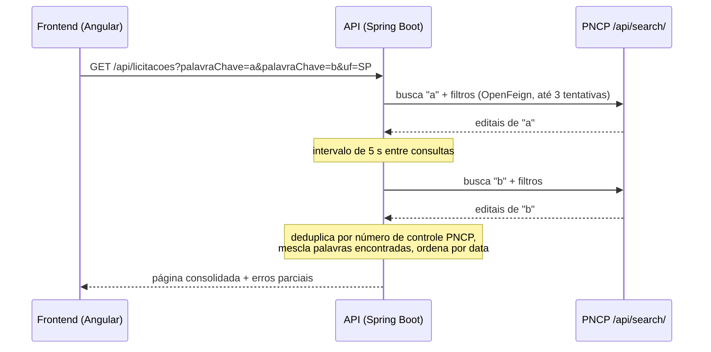

# Keko Licitações

Aplicação para encontrar editais de licitação abertos no **PNCP** (Portal Nacional de Contratações Públicas) buscando várias palavras-chave de uma vez, com filtros por estado, modalidade e situação.

- **Frontend:** <https://keko-licitacoes-front.onrender.com>
- **API:** <https://keko-licitacoes-api.onrender.com/api/licitacoes>

> Os dois serviços estão no plano gratuito do Render. Depois de um tempo sem uso, a API "dorme", e a primeira requisição pode levar de 15 a 60 segundos.

## Problema

Quem fornece para o setor público precisa acompanhar diariamente editais que tenham a ver com o seu negócio. No portal do PNCP, cada busca aceita um termo por vez. Para monitorar "notebook", "monitor" e "computador", é preciso fazer três buscas, aplicar os mesmos filtros em cada uma e cruzar os resultados à mão.

O Keko faz isso em uma única busca: consulta o PNCP uma vez por palavra-chave, consolida os resultados, remove os editais repetidos e mostra quais palavras encontraram cada edital.

## Funcionalidades

- Busca por **várias palavras-chave** em uma única requisição.
- Filtros por UF, modalidade (pregão eletrônico, concorrência, dispensa etc.), situação e tipo de documento.
- **Deduplicação** de editais encontrados por mais de uma palavra-chave, indicando quais palavras encontraram cada um (`matchedKeywords`).
- Ordenação dos resultados consolidados por data de publicação, do mais recente para o mais antigo.
- **Falha parcial tolerada**: se a consulta de uma palavra falhar, as outras continuam e a falha aparece no campo `erros` da resposta.
- Paginação.
- Link direto para o edital no portal do PNCP.

## Como funciona



Decisões técnicas:

- **Consultas sequenciais com intervalo de 5 segundos** entre palavras-chave, para não sobrecarregar a API pública do PNCP. O intervalo fica atrás da interface `KeywordSearchDelay`, que é substituída por um mock nos testes.
- **Retry do cliente HTTP** (`PncpFeignConfiguration`): até 3 tentativas, com espera de 1 s a 3 s entre elas.
- **Erros padronizados** com `ProblemDetail` (RFC 9457): uma falha do PNCP em busca sem palavra-chave retorna `502 Bad Gateway`.
- **DTOs imutáveis** com `record`, separando o contrato do PNCP (`PncpSearchItem`) do contrato da própria API (`LicitacaoResponse`).
- **CORS restrito** às origens configuradas, liberando apenas `GET` e `OPTIONS`.

## Stack

| Camada | Tecnologias |
|---|---|
| Backend | Java 21, Spring Boot 4.1, Spring Web MVC, Spring Cloud OpenFeign 2025.1, Bean Validation |
| Frontend | Angular 21 (standalone components, signals), TypeScript 5.9 |
| Testes | JUnit 5, Mockito, AssertJ (backend) · Vitest com Angular TestBed (frontend) |
| Infra | Docker (build multi-stage), Render (Blueprint em `render.yaml`) |

## Estrutura

```text
keko-licitacoes/
├── keko-licitacoes-api/          Backend Spring Boot
│   ├── src/main/java/br/com/keko/keko_licitacoes/
│   │   ├── licitacoes/           Controller, serviço de busca e DTOs da API
│   │   ├── pncp/                 Cliente Feign e DTOs do PNCP
│   │   └── shared/               Tratamento de erros e CORS
│   └── Dockerfile
├── keko-licitacoes-front/        Frontend Angular
└── render.yaml                   Deploy dos dois serviços no Render
```

## Executando localmente

**Pré-requisitos:** Java 21 e Node.js 24 com npm. O Maven não é necessário, porque o projeto inclui o Maven Wrapper.

### Backend

```bash
cd keko-licitacoes-api
./mvnw spring-boot:run
```

No Windows, use `mvnw.cmd spring-boot:run`. A API sobe em `http://localhost:8080`.

### Frontend

Em outro terminal:

```bash
cd keko-licitacoes-front
npm ci
npm start
```

Acesse `http://localhost:4200`. Em desenvolvimento, o frontend consome a API em `http://localhost:8080/api/licitacoes`.

### Com Docker (somente a API)

```bash
docker build -t keko-licitacoes-api ./keko-licitacoes-api
docker run -p 8080:8080 keko-licitacoes-api
```

## API

### `GET /api/licitacoes`

| Parâmetro | Tipo | Padrão | Descrição |
|---|---|---|---|
| `palavraChave` | texto, repetível | — | Termo de busca. Repita o parâmetro para buscar várias palavras. Termos vazios e duplicados são ignorados, sem diferenciar maiúsculas de minúsculas. |
| `uf` | texto, repetível | — | Sigla do estado (`SP`, `RJ` etc.). |
| `modalidade` | número, repetível | — | Código da modalidade no PNCP (ex.: `6` = pregão eletrônico, `8` = dispensa). |
| `status` | texto | `recebendo_proposta` | `recebendo_proposta`, `propostas_encerradas`, `encerradas` ou `todos`. |
| `tiposDocumento` | texto | `edital` | Tipo de documento no PNCP. |
| `ordenacao` | texto | `-data` | Ordenação repassada ao PNCP. |
| `pagina` | número | `1` | Página desejada (mínimo 1). |
| `tamanhoPagina` | número | `10` | Itens por página (de 1 a 100). |

Exemplo:

```bash
curl "http://localhost:8080/api/licitacoes?palavraChave=notebook&palavraChave=monitor&uf=SP&modalidade=6"
```

Formato da resposta (valores ilustrativos):

```json
{
  "pagina": 1,
  "tamanhoPagina": 10,
  "totalRegistros": 2,
  "totalPaginas": 1,
  "paginasRestantes": 0,
  "resultados": [
    {
      "fonte": "PNCP",
      "idExterno": "00000000000100-1-000001/2026",
      "orgao": "Prefeitura Municipal de Exemplo",
      "uf": "SP",
      "municipio": "Exemplo",
      "modalidade": "Pregão - Eletrônico",
      "modalidadeId": 6,
      "objeto": "Aquisição de notebooks e monitores",
      "dataPublicacao": "2026-09-10T10:00:00",
      "valorEstimado": 150000.00,
      "link": "https://pncp.gov.br/app/editais/...",
      "matchedKeywords": ["notebook", "monitor"]
    }
  ],
  "erros": []
}
```

Quando a consulta de uma das palavras-chave falha, os resultados das outras são retornados normalmente e a falha aparece em `erros`:

```json
"erros": [
  { "palavraChave": "computador", "mensagem": "Nao foi possivel consultar esta palavra-chave no PNCP." }
]
```

## Configuração

| Propriedade / variável | Padrão | Uso |
|---|---|---|
| `pncp.search.url` | `https://pncp.gov.br` | URL base do PNCP |
| `app.cors.allowed-origins` / `APP_CORS_ALLOWED_ORIGINS` | `http://localhost:4200,http://127.0.0.1:4200` | Origens liberadas no CORS (separadas por vírgula) |
| `PORT` | `8080` | Porta HTTP no perfil `prod` |
| `SPRING_PROFILES_ACTIVE` | — | Use `prod` em produção para carregar `application-prod.properties` |

Timeouts do cliente PNCP: 10 s para conexão e 30 s para leitura (`application.properties`).

No frontend, a URL da API fica em `src/environments/environment.ts` (local) e `environment.prod.ts` (produção).

## Testes

```bash
# Backend
cd keko-licitacoes-api
./mvnw test

# Frontend
cd keko-licitacoes-front
npm test
```

O que está coberto:

- **Backend** (`LicitacaoSearchServiceTest`, JUnit 5 + Mockito): uma consulta por palavra-chave, mantendo os filtros e o intervalo entre as consultas na ordem correta; deduplicação e mescla das palavras encontradas; ordenação depois da agregação; continuidade da busca quando uma palavra falha; descarte de palavras vazias e duplicadas.
- **Frontend** (Vitest): envio de um parâmetro `palavraChave` por palavra adicionada; descarte de palavras vazias e duplicadas; criação, remoção e exibição dos chips de palavra-chave.

## Deploy

O arquivo [`render.yaml`](render.yaml) é um Blueprint do Render com dois serviços:

- `keko-licitacoes-api`: Web Service a partir do `Dockerfile`, com `SPRING_PROFILES_ACTIVE=prod`.
- `keko-licitacoes-front`: Static Site gerado com `npm run build -- --configuration production`, com rewrite para `index.html`.

Se o Render gerar outro subdomínio, ajuste `environment.prod.ts` e `APP_CORS_ALLOWED_ORIGINS`.

## Limitações conhecidas

- **Paginação com várias palavras-chave:** cada página traz até `tamanhoPagina` resultados *por palavra*. Por isso, `totalRegistros` reflete os resultados consolidados daquela página, e não o total existente no PNCP.
- **Tempo de resposta:** como o intervalo entre consultas é de 5 segundos, uma busca com N palavras leva pelo menos 5 × (N − 1) segundos e mantém a requisição HTTP aberta durante esse tempo.
- **Frontend com uma UF por vez:** a API aceita várias UFs, mas a tela permite escolher só uma.
- **Sem persistência:** as dependências de JPA e PostgreSQL já estão no `pom.xml`, mas a configuração automática do banco está desativada. Nada é armazenado.
- **Sem autenticação:** a API é pública e somente leitura.

## Próximos passos

- Buscar editais em outras fontes além do PNCP.
- Salvar buscas e notificar quando surgirem novos editais (usando a persistência já prevista).
- Documentação OpenAPI/Swagger.
- Pipeline de CI (build e testes) no GitHub Actions.
